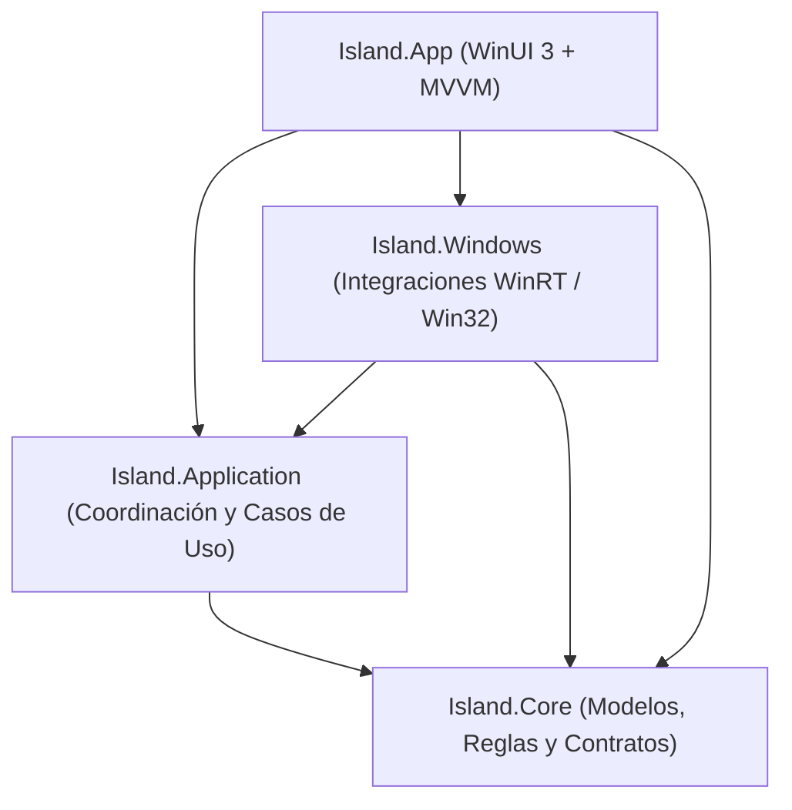

# 02. Decisiones de Arquitectura

**Fecha de actualización:** 29 de octubre de 2026  
**Fase actual:** Fase 3 — Coordinación (Completada)

---

## 1. Principios rectores

1. **Proceso único modular (sin microservicios ni procesos auxiliares innecesarios):**
   - La aplicación se ejecuta como un único proceso de escritorio residente en Windows 11.
   - La separación en proyectos responde al control de dependencias y facilidad de pruebas unitarias, no a aislamiento frente a fallos nativos del proceso.
2. **Aislamiento de APIs de Windows respecto al núcleo:**
   - Ni el dominio (`Island.Core`) ni el coordinador de casos de uso (`Island.Application`) referencian tipos de `Microsoft.UI.*`, `Windows.Media.*`, `Windows.UI.Notifications.*` ni llamadas `P/Invoke` (`user32.dll`, `shell32.dll`, etc.).
3. **Interfaz reactiva conducida por un coordinador único:**
   - Ninguna integración (Spotify/GSMTC, WhatsApp/UserNotificationListener, audio o detector de pantalla completa) modifica directamente la visibilidad ni el tamaño de la ventana.
   - Todas las integraciones emiten eventos normalizados hacia `Island.Application`, donde el coordinador aplica prioridades, colas, temporizadores cancelables y políticas antes de exponer el estado visual resultante a `Island.App`.

---

## 2. Estructura de la solución propuesta

```text
src/
  Island.Core/
    Modelos de dominio, máquina de estados dimensional, contratos de capacidades,
    esquemas de configuración y temas declarativos, reloj abstracto (ITimeProvider / TimeProvider).

  Island.Application/
    Coordinador central de estados de la isla, gestor de colas y caducidad de avisos,
    priorización de interacción del usuario frente a eventos automáticos,
    gestión de preferencias y persistencia segura con recuperación.

  Island.Windows/
    Implementaciones específicas de Windows (GSMTC, UserNotificationListener,
    enumeración de audio, estado de pantalla completa, posicionamiento DPI/monitores,
    adaptadores Win32/AppWindow). Traduce datos de Windows a modelos de Island.Core.

  Island.App/
    Ejecutable WinUI 3 empaquetado (MSIX), ViewModels (CommunityToolkit.Mvvm),
    diccionarios de recursos, materiales con degradación controlada (Acrylic/Mica/Sólido),
    bandeja del sistema, atajos de teclado y vistas de configuración.

tests/
  Island.Core.Tests/
    Pruebas unitarias deterministas de estados, reglas, validación de temas y configuración.

  Island.Application.Tests/
    Pruebas de coordinación, concurrencia, ráfagas de avisos, cancelación de temporizadores
    y prioridades usando reloj simulado y proveedores simulados (explícitamente marcados).

  Island.Windows.IntegrationTests/
    Pruebas e arneses de verificación sobre APIs reales de Windows (GSMTC, notificaciones,
    monitores/DPI y ventana).
```

---

## 3. Regla de dirección de dependencias



- `Island.Core` no depende de ningún otro proyecto de la solución ni de SDKs específicos de Windows.
- `Island.Application` depende únicamente de `Island.Core`.
- `Island.Windows` depende de `Island.Core` (y opcionalmente de contratos de `Island.Application`), implementando los adaptadores del sistema operativo.
- `Island.App` ensambla las dependencias (composición en el arranque) y representa el estado expuesto por `Island.Application`.

---

## 4. Modelo de estado multidimensional (Coordinación)

Para evitar explosión combinatoria de estados monolíticos, el estado de la isla se modela en 4 dimensiones ortogonales (**Comprobado** en `IslandStructuralCoordinator`, `MediaSessionCoordinator` y `NotificationQueueCoordinator`):

| Dimensión | Valores admitidos | Regla principal |
| :--- | :--- | :--- |
| **Visibilidad** | `Hidden`, `Compact`, `Expanded` | Determina la huella geométrica de la isla en pantalla. |
| **Interacción** | `Passive`, `ActiveInUse`, `PinnedOpen` | Si es `ActiveInUse` o `PinnedOpen`, ningún evento automático puede contraer la isla ni reemplazar el panel activo. |
| **Contenido** | `Idle`, `MediaSummary`, `NotificationToast`, `ControlCenter` | Define qué plantilla visual se presenta en la región activa. |
| **Política** | `Normal`, `Paused` (ej. pantalla completa / no molestar), `Private` (ocultar texto sensible) | Gobierna si las transiciones automáticas pueden dispararse y qué nivel de detalle muestran. |

---

## 5. Declaración explícita de capacidades por módulo

Cada módulo de `Island.Windows` debe exponer su estado operativo mediante un contrato común (`IntegrationCapabilityStatus`):

- `Available`: Operativo y verificado en tiempo de ejecución.
- `PermissionRequired`: Requiere consentimiento explícito del usuario (ej. acceso a notificaciones en Configuración de Windows).
- `PermissionDenied`: El usuario rechazó o revocó el permiso.
- `PartiallySupported`: La aplicación origen no expone todos los metadatos o comandos (ej. reproductor sin duración o sin carátula).
- `Disconnected`: Servicio o sesión no disponible temporalmente.
- `Faulted`: Error capturado en la integración; el módulo queda aislado sin tumbar los demás módulos ni la interfaz.

---

## 6. Arquitectura de temas y materiales

1. **Separación entre Material Solicitado y Material Efectivo:**
   - El tema o usuario solicita `Solid`, `Glass` (Acrylic) o `Mica`.
   - El motor visual evalúa soporte real de la versión de Windows App SDK, estado de transparencia del sistema, ahorro de energía y modo de Alto Contraste, registrando qué material efectivo se aplicó (`SolidFallback`, `DesktopAcrylic`, `Mica`, `HighContrastSolid`).
2. **Temas 100% declarativos (JSON versionado):**
   - Prohibido cargar XAML arbitrario externo, ensamblados dinámicos o scripts desde temas.
   - Validación estricta de rangos (radios de esquina, márgenes, colores hexadecimales/ARGB, perfiles de duración) antes de aplicar.
   - Si un archivo de tema falla al validarse, se conserva el último tema válido en memoria o se conmuta al tema `Solid` integrado de respaldo, registrando la incidencia.
## 7. Decisiones técnicas incorporadas tras la Fase 2 (Viabilidad nativa)

1. **Paso de clics (Click-through) mediante recorte geométrico de región (`SetWindowRgn`) sincronizado con el tamaño de la isla:**
   - Se comprobó con `WindowFromPoint` que aplicar `CreateRoundRectRgn` + `SetWindowRgn` a las coordenadas exactas de la píldora dentro del `HWND` permite que cualquier clic en el área exterior llegue directamente a la ventana subyacente (`ExteriorTransparentClickThroughPassed = true`), mientras el interior de la píldora recibe eventos en `Microsoft.UI.Content.DesktopChildSiteBridge` (`InteriorIslandHitTestPassed = true`).
2. **Preservación de foco en avisos pasivos:**
   - Mientras la dimensión de interacción sea `Passive`, el `HWND` mantiene el estilo extendido `WS_EX_NOACTIVATE` y se posiciona con `SWP_NOACTIVATE` / `SW_SHOWNOACTIVATE`. Solo cuando el usuario interactúa explícitamente (`ActiveInUse` / `PinnedOpen`) se habilita la activación para navegación por teclado.
3. **Mitigación comprobada para la incidencia #6172 de `UserNotificationListener`:**
   - En Windows 11 Build `26300`, `UserNotificationListener.GetNotificationsAsync(NotificationKinds.Toast)` funciona incluso sin identidad MSIX cuando el acceso está permitido (`AccessState = Allowed`), leyendo notificaciones reales de WhatsApp (`5319275A.WhatsAppDesktop_cv1g1gvanyjgm!App`), pero la suscripción a `NotificationChanged` falla con `COMException 0x80070490` cuando no hay identidad MSIX.
   - Por tanto, el adaptador de notificaciones implementa un **modo híbrido**: registra el `NotificationId` máximo existente al iniciar (para no mostrar notificaciones antiguas) y utiliza `NotificationChanged` si la suscripción tuvo éxito, o un observador diferencial ligero sobre `GetNotificationsAsync` si `NotificationChanged` devolvió `0x80070490`.
4. **Separación entre volumen del dispositivo (`CoreAudio`) y sesiones multimedia (`GSMTC`):**
   - Al haberse comprobado que coexisten 6 sesiones WASAPI con 2 sesiones GSMTC sin correspondencia directa, el control de volumen de la isla gobierna el volumen maestro del dispositivo de salida predeterminado (`IAudioEndpointVolume`), mientras los controles de transporte (`Play/Pause/Next/Prev`) gobiernan la sesión GSMTC seleccionada.

---

## 8. Decisiones técnicas comprobadas en Fase 3 (Coordinación)

1. **Protección generacional contra temporizadores obsoletos (`ActiveGenerationId`):**
   - Cada transición automática programa un `ITimer` sobre el `TimeProvider` inyectado asociándole el identificador monotónico `ActiveGenerationId`. Si el usuario interactúa (`BeginUserInteraction`, `SetPinned`), llega un evento de mayor prioridad o se oculta la isla antes de que venza el temporizador, la generación avanza y el callback vencido se descarta de forma determinista sin corromper la máquina de estados.
2. **Coordinación de avisos con marca de agua de arranque, deduplicación, agrupación de ráfagas y privacidad (`NotificationQueueCoordinator`):**
   - **Marca de agua (`SyncStartupWatermark`):** Registra el máximo `NotificationId` existente al iniciar la sesión para no re-mostrar avisos antiguos acumulados en el Centro de actividades.
   - **Lista blanca + deduplicación:** Filtra por AUMID permitido (ej. `5319275A.WhatsAppDesktop`), descarta identificadores ya vistos (`MaxSeenIdsRetained`) y rechaza contenido duplicado dentro de la ventana `DuplicateSuppressionWindow`.
   - **Coalescencia de ráfagas (`BurstWindow`):** Cuando llegan múltiples avisos del mismo remitente/aplicación en ráfaga, incrementa `BurstCount` y actualiza el aviso activo o en cola sin saturar la isla.
   - **Cola acotada y caducidad (`MaxQueueLength`, `QueueItemMaxAge`):** Descarta elementos vencidos antes de hacer `DequeueNextValid` y recorta los más antiguos si se supera la capacidad máxima.
   - **Política `Private`:** Oculta remitente y cuerpo sensible (`"Notificación privada"` / `"Contenido oculto por política de privacidad"`) en la vista proyectada sin alterar el evento subyacente si la política vuelve a `Normal`.
3. **Coordinación multi-reproductor y reconexión (`MediaSessionCoordinator`):**
   - Prioriza reproductores fijados manualmente (`PinSession`) si siguen presentes; en caso contrario selecciona reproducción activa (`Playing`) sobre pausa (`Paused`), dando prioridad a aplicaciones dedicadas (`Spotify`, `AppleMusic`) frente a pestañas de navegador.
   - Si el reproductor fijado se cierra o desconecta, limpia la fijación automáticamente y conmuta al siguiente reproductor activo o devuelve la isla a `Idle` sin bloquear el estado.
   - Detecta cambios reales de pista (`Title|Artist|AlbumTitle`) para disparar avisos breves de cambio de canción solo cuando la pista cambia durante reproducción activa.
4. **Monitor híbrido de notificaciones (`HybridNotificationMonitor`):**
   - Sincroniza la marca de agua inicial en `StartAsync`, intenta suscribirse a `NotificationChanged` y, si ocurre `COMException 0x80070490` (incidencia `#6172` en ejecución desempaquetada), conmuta automáticamente a lectura diferencial sobre `GetNotificationsAsync` usando la misma marca de agua.


